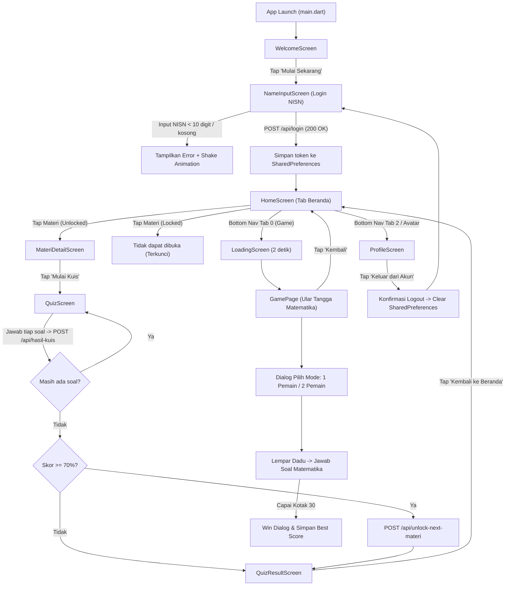

# Ayo Berhitung (`ayobitung`) — Deskripsi, Workflow, dan PRD

Dokumen ini merangkum deskripsi teknis, alur kerja (*workflow*), serta *Product Requirements Document* (PRD) dari repositori front-end Flutter **Ayo Berhitung** (`ayobitung`) berdasarkan inspeksi langsung seluruh kode sumber di dalam repositori.

---

## 1. Deskripsi Proyek

**Ayo Berhitung** (`ayobitung`) adalah aplikasi edukasi matematika berbasis **Flutter** yang menggabungkan pembelajaran materi terstruktur, kuis evaluasi bertahap (*progressive unlock*), serta permainan edukatif **Ular Tangga Matematika** (mode 1 pemain dan 2 pemain).

### 1.1 Informasi Umum & Tech Stack

| Atribut | Detail |
| :--- | :--- |
| **Nama Paket** | `ayobitung` (`pubspec.yaml`) |
| **Judul Aplikasi** | `Ayo Berhitung` (`lib/main.dart`) |
| **Versi** | `1.0.0+1` |
| **Dart SDK** | `^3.7.2` |
| **Framework** | Flutter (Material Design) |
| **Target Platform** | Android, iOS, Web, Linux, macOS, Windows (direktori platform tersedia) |
| **Backend Base URL** | `http://127.0.0.1:8000/api` (REST API berbasis Bearer Token) |

### 1.2 Dependensi Utama (`pubspec.yaml`)

- **`http` (`^0.13.3`)**: Komunikasi HTTP ke REST API backend (login, materi, kuis, submit hasil, unlock materi, statistik user).
- **`shared_preferences` (`^2.5.3`)**: Penyimpanan lokal (*persistent key-value*) untuk token autentikasi, progres materi, dan skor terbaik game.
- **`google_fonts` (`^4.0.4`)**: Tipografi menggunakan font `Poppins`, `Nunito`, dan `Inter`.
- **`audioplayers` (`^6.5.0`)**: Pemutaran musik latar (`assets/music/song.mp3`) secara *looping* pada fitur game Ular Tangga.
- **`shimmer` (`^3.0.0`)**: Efek *skeleton loading* pada halaman profil (`ProfileScreen`).
- **`font_awesome_flutter` (`^10.8.0`)**, **`animate_do` (`^2.1.0`)**, **`cupertino_icons` (`^1.0.8`)**: Ikon dan utilitas animasi tambahan.
- **`flutter_launcher_icons` (`^0.13.1`)**: Konfigurasi ikon aplikasi Android & iOS menggunakan `assets/images/ayo.png`.

### 1.3 Struktur Direktori (`lib/` & `assets/`)

```text
lib/
├── main.dart                         # Entry point aplikasi (MyApp -> WelcomeScreen)
├── widgets/
│   └── custom_button.dart            # File kosong (placeholder)
└── screens/
    ├── welcome_screen.dart           # Halaman sambutan / onboarding awal
    ├── name_input_screen.dart        # Halaman login / verifikasi NISN siswa
    ├── home_screen.dart              # Beranda utama (header, stats, daftar materi, bottom nav)
    ├── materi_detail_screen.dart     # Detail konten materi & tombol mulai kuis
    ├── quiz_screen.dart              # Halaman pengerjaan kuis (QuizScreen) & hasil (QuizResultScreen)
    ├── game_screen.dart              # Game Ular Tangga Matematika (SnakesLaddersQuiz / GamePage)
    ├── gameplay_screen.dart          # LoadingScreen transisi sebelum masuk ke GamePage
    ├── profile_screen.dart           # Profil siswa, skor total, gelar, & logout
    ├── login.dart                    # Prototipe/legacy LoginPage (tidak dipanggil dari main flow)
    ├── detail_screen_quiz.dart       # Prototipe/legacy QuizResultScreen (seluruhnya dikomentari)
    └── tetstinf.dart                 # Prototipe/legacy HomeScreen (seluruhnya dikomentari)

assets/
├── images/                           # Aset gambar (ayo.png, logo.jpg, background.png, hayy.png, dll.)
├── music/
│   └── song.mp3                      # Musik latar untuk game Ular Tangga Matematika
└── screenshot/
    └── one.png
```

---

## 2. Alur Kerja (Workflow) Aplikasi

### 2.1 Diagram Alur Pengguna (*User Flow*)



### 2.2 Penjelasan Alur Teknis Tiap Tahap

1. **Inisialisasi & Onboarding (`WelcomeScreen`)**:
   - Aplikasi dimulai dari `MyApp` di `lib/main.dart` yang langsung merender `WelcomeScreen`.
   - Menampilkan avatar berdenyut (`Icons.waving_hand_rounded`), teks sambutan `"SELAMAT DATANG!"`, lingkaran mengambang animasi, dan tombol **"Mulai Sekarang"** yang mengarahkan ke `NameInputScreen` dengan transisi geser (*slide transition*).

2. **Autentikasi Siswa (`NameInputScreen`)**:
   - Siswa memasukkan **NISN** (hanya angka, maksimal 10 digit, validasi tidak boleh kosong dan minimal 10 digit).
   - Menekan **"Verifikasi"** memanggil `POST http://127.0.0.1:8000/api/login` dengan body `{"nisn": "<nisn>"}`.
   - Jika berhasil (`200`), aplikasi mengambil `token`, `data_siswa.nama`, dan `data_siswa.nisn`, menyimpan `token` ke `SharedPreferences`, lalu berpindah (`pushReplacement`) ke `HomeScreen`.

3. **Beranda & Manajemen Progres Materi (`HomeScreen`)**:
   - Saat inisialisasi (`_loadInitialData`):
     1. Memuat `token` dari argumen widget atau `SharedPreferences`.
     2. Memanggil `GET /api/materi-unlock` untuk mendapatkan daftar `unlocked_materi_ids` dan menyimpannya ke `SharedPreferences` (`unlockedMateriIds_<nisn>`).
     3. Memuat progres lokal `completedMateriIds_<nisn>` dan `unlockedMateriIds_<nisn>` (default terbuka: materi ID `1`).
     4. Memanggil `GET /api/materi` untuk mengambil daftar seluruh materi, lalu mengurutkannya berdasarkan `id` secara menaik.
   - Materi yang belum termasuk dalam `_unlockedMateriIds` ditampilkan dengan opasitas `0.5`, ikon gembok, dan tidak dapat ditekan.

4. **Membaca Materi (`MateriDetailScreen`)**:
   - Mengambil detail materi via `GET /api/materi/{materiId}` (dengan timeout 20 detik).
   - Menampilkan gambar header (`gambar_url`) dalam `SliverAppBar` yang dapat diperluas (*stretchable*), judul materi, dan isi `konten`.
   - Menekan tombol **"Mulai Kuis"** di bagian bawah akan memanggil callback `onMateriCompleted(materiId)` (menandai selesai di `SharedPreferences`) dan membuka `QuizScreen(kuisId: materiId)`.

5. **Pengerjaan Kuis & Evaluasi (`QuizScreen` & `QuizResultScreen`)**:
   - Mengambil daftar soal via `GET /api/kuis/{kuisId}`.
   - Setiap soal memiliki 4 pilihan (`jawaban_a`, `jawaban_b`, `jawaban_c`, `jawaban_d`) yang dipetakan menjadi `'a'`, `'b'`, `'c'`, `'d'`.
   - Saat menekan **"Lanjutkan"** / **"Selesai"**:
     - Mengirim jawaban ke `POST /api/hasil-kuis` dengan `kuis_id` dan `jawaban_user`.
     - Menghitung skor lokal (`soal['nilai'] ?? 10` jika benar, `0` jika salah) dan menyimpannya ke `hasilKuisData`.
   - Pada soal terakhir:
     - Menghitung persentase skor (`(totalSkor / maxSkor) * 100`).
     - Jika `percentage >= 70`, aplikasi memanggil `POST /api/unlock-next-materi` dengan `{"materi_id": materiId}` untuk membuka materi berikutnya di server.
     - Berpindah ke `QuizResultScreen` yang menampilkan persentase, jumlah benar, total skor, rincian jawaban per soal beserta pembahasan, dan tombol **"Kembali ke Beranda"**.

6. **Permainan Ular Tangga Matematika (`LoadingScreen` -> `GamePage`)**:
   - Dari `HomeScreen`, memilih tab **Game** (index `0`) menampilkan `LoadingScreen` selama 2 detik sebelum masuk ke `GamePage`.
   - Musik latar (`assets/music/song.mp3`) diputar otomatis secara *loop* (dapat di-*pause/resume* lewat tombol volume).
   - Pemain memilih mode **1 Pemain (Solo)** atau **2 Pemain (Duel)**.
   - Papan berukuran **30 kotak** (grid 6 kolom × 5 baris dengan penomoran zig-zag dari kiri bawah).
   - **Tangga**: `3→22`, `5→8`, `11→26`, `20→29`. **Ular**: `27→1`, `21→9`, `17→4`, `19→7`.
   - Setiap lemparan dadu mengharuskan pemain menjawab soal aritmatika yang digenerate otomatis sesuai rentang kotak:
     - Kotak `1–6`: Penjumlahan (`1–20`)
     - Kotak `7–12`: Pengurangan (`10–40`, hasil ≥ 0)
     - Kotak `13–18`: Perkalian (`2–12`)
     - Kotak `19–24`: Pembagian bulat (`2–12`)
     - Kotak `25–30`: Operasi campuran (`+`, `-`, `×`, `÷`)
   - Jika mendarat di tangga/ular, muncul **Soal Bonus** untuk menentukan apakah pemain berhasil naik tangga atau selamat dari ular.
   - Mencapai tepat kotak `30` memicu `showWinDialog`. Pada mode 1 pemain, jumlah lemparan paling sedikit disimpan sebagai `bestScore` di `SharedPreferences`.

7. **Profil Siswa & Logout (`ProfileScreen`)**:
   - Menampilkan *shimmer loading* selama ~2 detik, lalu memanggil `POST /api/login` (dengan `nisn`) dan `GET /api/user/stats` untuk menampilkan `nama`, `nisn`, `kelas`, `sekolah`, `alamat`, `total_skor`, dan `gelar`.
   - Jika koneksi ke API gagal, kode memiliki *fallback* data dummy (`Siswa Contoh`, `SMP Negeri 1 Merawang`, skor `1500`, gelar `Pejuang Hebat`).
   - Tombol **"Keluar dari Akun"** menampilkan dialog konfirmasi, menghapus seluruh `SharedPreferences` (`prefs.clear()`), dan mengarahkan kembali ke `NameInputScreen`.

---

## 3. Product Requirements Document (PRD)

### 3.1 Latar Belakang & Tujuan Produk
- **Tujuan**: Menyediakan media pembelajaran matematika interaktif bagi siswa sekolah melalui kombinasi materi bacaan, kuis evaluasi berjenjang, dan gamifikasi berbasis papan permainan Ular Tangga.
- **Target Pengguna**: Siswa sekolah (teridentifikasi dari penggunaan **NISN** sebagai kredensial login dan referensi default tingkat SMP pada model `Siswa`).

### 3.2 Ruang Lingkup Fitur & Kebutuhan Fungsional

#### Modul 1: Onboarding & Autentikasi
| ID | Fitur | Deskripsi & Kriteria Penerimaan |
| :--- | :--- | :--- |
| **FR-01** | Layar Sambutan | Menampilkan animasi sambutan dan tombol CTA `"Mulai Sekarang"` menuju halaman login. |
| **FR-02** | Login via NISN | Input numerik khusus digit, panjang tepat/minimal 10 digit. Menampilkan pesan error animasi (*shake* + banner merah selama 3 detik) jika kosong, < 10 digit, atau ditolak server. |
| **FR-03** | Manajemen Token Sesi | Menyimpan Bearer Token di `SharedPreferences` (`token`) setelah login berhasil untuk otorisasi seluruh request API berikutnya. |

#### Modul 2: Beranda & Kurikulum Materi
| ID | Fitur | Deskripsi & Kriteria Penerimaan |
| :--- | :--- | :--- |
| **FR-04** | Header Personalisasi | Menampilkan sapaan dinamis berbasis waktu lokal (Pagi `<10`, Siang `<15`, Sore `<18`, Malam `>=18`), nama siswa, avatar inisial (Hero ke Profil), dan teks motivasi harian. |
| **FR-05** | Kartu Statistik Ringkas | Menampilkan 3 kartu ringkasan (`Materi`, `Progress`, `Streak`). *(Catatan: saat ini nilainya masih statis `'4'`, `'75%'`, `'5 hari'` di `home_screen.dart`).* |
| **FR-06** | Daftar Materi & Status Kunci | Mengambil daftar materi dari API, mengurutkan berdasarkan `id`, dan mengunci materi yang belum ada di `unlocked_materi_ids` (kecuali materi 1 sebagai default fallback lokal). |
| **FR-07** | Navigasi Bawah (*Bottom Nav*) | Menyediakan 3 tab utama: **Game** (index 0), **Home** (index 1), dan **Profil** (index 2). |

#### Modul 3: Pembelajaran Materi & Kuis
| ID | Fitur | Deskripsi & Kriteria Penerimaan |
| :--- | :--- | :--- |
| **FR-08** | Detail Materi | Menampilkan gambar ilustrasi (`SliverAppBar`), judul, dan teks konten materi. Menyediakan state loading, state error dengan tombol `"Coba Lagi"`, serta tombol `"Mulai Kuis"`. |
| **FR-09** | Pengerjaan Kuis | Menampilkan progres soal (`Pertanyaan X dari Y` & progress bar), teks pertanyaan, dan 4 opsi pilihan ganda (`A–D`). Jawaban dikirim ke server per soal (`POST /api/hasil-kuis`). |
| **FR-10** | Mekanisme *Unlock* Materi | Jika persentase nilai akhir kuis `>= 70%`, sistem memanggil `POST /api/unlock-next-materi` agar materi berikutnya terbuka. |
| **FR-11** | Halaman Hasil Kuis | Menampilkan kategori performa (`Luar Biasa!` `>=80%`, `Bagus!` `>=60%`, `Tetap Semangat!` `<60%`), total skor, jumlah benar, detail jawaban & pembahasan tiap soal, serta tombol kembali ke beranda. |

#### Modul 4: Game Ular Tangga Matematika
| ID | Fitur | Deskripsi & Kriteria Penerimaan |
| :--- | :--- | :--- |
| **FR-12** | Pemilihan Mode Game | Dialog wajib di awal permainan untuk memilih **1 Pemain (Solo)** atau **2 Pemain (Duel)**. |
| **FR-13** | Mekanika Papan & Dadu | Papan 30 kotak (6×5 zig-zag), animasi kocok dadu 1–6, aturan langkah pas di kotak 30, serta interaksi tangga (naik jika soal bonus benar) dan ular (selamat jika soal bonus benar, turun jika salah). |
| **FR-14** | Generator Soal Dinamis | Soal aritmatika (+, -, ×, ÷, campuran) digenerate otomatis dengan tingkat kesulitan bertahap sesuai nomor kotak target. |
| **FR-15** | Musik Latar & Skor Terbaik | Memutar `assets/music/song.mp3` berulang dengan kontrol *mute/unmute*, serta menyimpan rekor lemparan tersedikit (*best score*) untuk mode Solo di `SharedPreferences`. |

#### Modul 5: Profil & Akun
| ID | Fitur | Deskripsi & Kriteria Penerimaan |
| :--- | :--- | :--- |
| **FR-16** | Informasi Profil & Statistik | Menampilkan foto/inisial avatar, nama, NISN, gelar peringkat, total skor, kelas, sekolah, dan alamat. |
| **FR-17** | Logout | Dialog konfirmasi sebelum menghapus seluruh data `SharedPreferences` dan mengembalikan pengguna ke halaman login. |

---

### 3.3 Spesifikasi Integrasi API & Penyimpanan Lokal

#### Endpoint REST API (`http://127.0.0.1:8000/api`)

| Method | Endpoint | Header Auth | Payload / Query | Respons yang Diharapkan |
| :--- | :--- | :--- | :--- | :--- |
| `POST` | `/login` | - | `{"nisn": "..."}` | `token`, `data_siswa` (`nama`, `nisn`, `kelas`, `profile_picture`, `sekolah`, `alamat`) |
| `GET` | `/materi` | `Bearer <token>` | - | Array objek materi (`id`, `judul`, dll.) |
| `GET` | `/materi-unlock` | `Bearer <token>` | - | `{"unlocked_materi_ids": [1, ...]}` |
| `GET` | `/materi/{id}` | `Bearer <token>` | - | `konten`, `gambar_url` |
| `GET` | `/kuis/{id}` | `Bearer <token>` | - | `kuis` (List atau Map berisi `id`, `materi_id`, `pertanyaan`, `jawaban_a..d`, `jawaban_benar`, `nilai`, `pembahasan`) |
| `POST` | `/hasil-kuis` | `Bearer <token>` | `{"kuis_id": int, "jawaban_user": "a"\|"b"\|"c"\|"d"}` | Status `200` |
| `POST` | `/unlock-next-materi` | `Bearer <token>` | `{"materi_id": int}` | `{"message": "..."}` |
| `GET` | `/user/stats` | `Bearer <token>` | - | `total_skor`, `gelar` |

#### Kunci `SharedPreferences`
- `token` (`String`): Token autentikasi Bearer.
- `completedMateriIds_<nisn>` (`List<String>`): Daftar ID materi yang telah ditandai selesai secara lokal.
- `unlockedMateriIds_<nisn>` (`List<String>`): Daftar ID materi yang terbuka untuk NISN terkait.
- `bestScore` (`int`): Rekor jumlah lemparan tersedikit pada mode 1 pemain di game Ular Tangga.
- `userName` & `nisn` (`String`): Dibaca oleh `QuizResultScreen` saat kembali ke beranda.

---

### 3.4 Persyaratan Non-Fungsional
- **Usability & Feedback**: Menggunakan `HapticFeedback.lightImpact()` / `mediumImpact()` pada aksi penting, animasi transisi halaman (`FadeTransition`, `SlideTransition`), serta *SnackBar* informatif pada game dan kuis.
- **Keandalan Jaringan**: Request detail materi memiliki batas waktu (`timeout`) 20 detik dengan tampilan error dan tombol coba lagi.
- **Performa UI**: Menggunakan `BouncingScrollPhysics`, *shimmer placeholder* pada pemuatan profil, dan manajemen `AnimationController.dispose()` serta `AudioPlayer.dispose()` untuk mencegah kebocoran memori.

---

### 3.5 Catatan Teknis & Temuan Kode Saat Ini (Untuk Pengembangan Lanjutan)
Berikut adalah beberapa hal yang ditemukan langsung di dalam kode dan relevan untuk perbaikan/iterasi berikutnya:
1. **Hardcoded Base URL**: Alamat `http://127.0.0.1:8000/api` ditulis langsung (*hardcoded*) di beberapa file (`name_input_screen.dart`, `home_screen.dart`, `materi_detail_screen.dart`, `quiz_screen.dart`, `profile_screen.dart`). Sebaiknya dipusatkan ke satu file konfigurasi/service (dan disesuaikan untuk emulator Android `10.0.2.2` atau domain produksi).
2. **Statistik Statis di `HomeScreen`**: Kartu `Materi` (`4`), `Progress` (`75%`), dan `Streak` (`5 hari`) di `lib/screens/home_screen.dart` masih berupa nilai statis (*hardcoded*), belum terhubung ke data API atau kalkulasi progres aktual.
3. **Inkonsistensi `SharedPreferences` di `QuizResultScreen`**: `QuizResultScreen` (`lib/screens/quiz_screen.dart`) membaca `prefs.getString('userName')` dan `prefs.getString('nisn')` saat kembali ke `HomeScreen`, padahal `NameInputScreen` saat login hanya menyimpan `token` ke `SharedPreferences` (sehingga fallback `'Siswa'` dan `''` akan terpakai jika `userName`/`nisn` tidak ikut disimpan saat login).
4. **Inkonsistensi Bottom Navigation di `ProfileScreen`**: Label tab pada `ProfileScreen` (`Materi`, `Beranda`, `Profil`) berbeda dengan `HomeScreen` (`Game`, `Home`, `Profil`), dan menekan tab `0` maupun `1` di `ProfileScreen` sama-sama mengarahkan ke `HomeScreen`.
5. **Fallback Data Dummy di `ProfileScreen`**: Saat terjadi kegagalan jaringan di `ProfileScreen._loadAllProfileData()`, catch block mengisi data dummy (`Siswa Contoh`, skor `1500`) alih-alih menampilkan error state.
6. **File Legacy / Tidak Terpakai**: Terdapat file yang tidak digunakan dalam alur utama aplikasi: `lib/widgets/custom_button.dart` (kosong), `lib/screens/login.dart`, `lib/screens/detail_screen_quiz.dart` (dikomentari), dan `lib/screens/tetstinf.dart` (dikomentari).
7. **Pengujian (`test/widget_test.dart`)**: File test masih berisi *smoke test* default Flutter (counter app) yang tidak lagi sesuai dengan widget `WelcomeScreen` pada `MyApp`.
